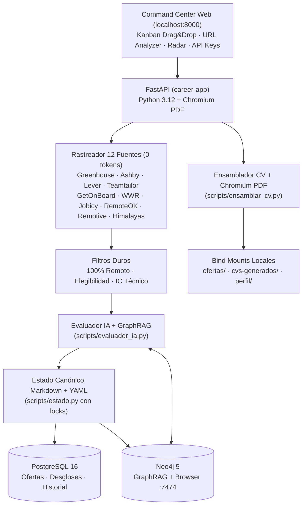

# Career Agent System

Sistema multi-agente open-source para búsqueda inteligente de empleo remoto, evaluación con rúbrica 0–100 asistida por **Neo4j GraphRAG**, generación de CVs optimizados para ATS (Markdown, HTML y PDF) y gestión visual tipo **Command Center** en **Docker Compose**.

Diseñado para correr **bajo demanda en tu propio computador** (enciendes Docker cuando buscas/postulas, apagas con `docker compose down` sin perder tus datos) y listo para ejecutarse también en **CI/CD** o desde consola con agentes IA (**Antigravity**, **Claude Code**, **Cursor** o **Gemini CLI**).

---

## Características principales

* **Infraestructura Docker desacoplada y persistente:**
  * **PostgreSQL 16** (`career_pgdata`): persiste ofertas, estados, desglose de puntajes e historial.
  * **Neo4j 5 Community** (`career_neo4j_data`): grafo de conocimiento `(Perfil)→(Logro)→(Skill)←(Oferta)` usado activamente por la IA (**GraphRAG**) + **Neo4j Browser** en `http://localhost:7474`.
  * **Career App (FastAPI + Chromium)** (`http://localhost:8000`): Dashboard Web estilo *Linear/Vercel* ([`DESIGN.md`](DESIGN.md)), API REST, rastreador multi-fuente y renderizador HTML→PDF sin dependencias en tu host.
  * **Bind mounts locales:** tus archivos Markdown (`ofertas/`), perfil (`perfil/`) y PDFs (`cvs-generados/`) viven directamente en tus carpetas locales (cero vendor lock-in).
* **Rastreo directo en 12 fuentes vivas (0 tokens de captura):**
  * **ATS oficiales:** Greenhouse, Ashby, Lever, **Teamtailor** (fintechs Chile/LatAm), Breezy y SmartRecruiters — configurables en [`perfil/empresas-target.yaml`](perfil/empresas-target.yaml).
  * **Portales remotos públicos:** Get on Board, We Work Remotely, Jobicy, RemoteOK, Remotive y Himalayas.
  * **Filtros duros previos a la IA:** descarta automáticamente vacantes presenciales/híbridas, restringidas a un solo país externo (*US Only / EU Only / UK Only*) y cargos de gestión/seniority excesivo antes de gastar tokens.
* **Matriz Multi-Agente por Rol (ahorro de tokens):**
  * Configura un proveedor y modelo distinto para cada agente interno (`perfil-tracker`, `buscador-ofertas`, `adaptador-cv`, `preparador-entrevistas`) directamente desde la web.
  * Soporta **OpenRouter** (incluidos modelos gratuitos `:free` / `openrouter/free`), **Google Gemini API**, **Anthropic Claude**, **OpenAI**, **Ollama local** y **Antigravity CLI (`agy`)**.
* **Command Center Web (6 módulos):**
  1. **Tablero Kanban:** Drag & Drop entre etapas (`Evaluada → CV Listo → Postulado → Entrevista HR → Técnica/Oferta`), zonas de descarte/rechazo, panel lateral con desglose de rúbrica 0–100, logros coincidentes de Neo4j GraphRAG y **visor PDF embebido**.
  2. **Buscar y Analizar:** Lanzador de rastreo multi-fuente con consola en vivo + analizador instantáneo de cualquier URL con IA.
  3. **Radar Neo4j:** Fortalezas cubiertas vs. brechas prioritarias de mercado + consultas Cypher copiables.
  4. **Rechazados / Archivo:** Historial completo de ofertas rechazadas por empresas y descartadas, con buscador, motivos y restauración en 1 clic.
  5. **API Keys & IA:** Gestión local de llaves (`postulaciones/.ai-config.json`, ignorado por Git, `chmod 600`), matriz por rol, preset *Ahorro Máximo* y botón **Probar Conexión IA** por rol.
  6. **Cómo Funciona:** Checklist interactivo de puesta en marcha.

---

## Arquitectura



---

## Inicio Rápido (Docker Compose — Recomendado)

### Requisitos
* Docker y Docker Compose v2+ (`docker compose version`)
* Una API Key de IA — recomendada **OpenRouter** (`https://openrouter.ai/keys`, soporta modelos `:free`) o **Google AI Studio** (`https://aistudio.google.com/apikey`, capa gratuita). También puedes usar **Ollama local**.

### Pasos (3 minutos)

```bash
# 1. Clonar el repositorio
git clone https://github.com/felipevergara19/career-agent.git
cd career-agent

# 2. Preparar carpetas locales, .env (con tu UID/GID) y plantillas de perfil
chmod +x scripts/setup.sh
./scripts/setup.sh

# 3. Edita tu perfil real y tus reglas/rúbrica de búsqueda
#    - perfil/perfil-maestro.md   (tu stack, logros cuantificados e idiomas)
#    - perfil/preferencias.md     (país, remoto, rango salarial y rúbrica 0-100)
#    - perfil/empresas-target.yaml (empresas/ATS que quieres monitorear)

# 4. Construir y levantar la infraestructura desacoplada
docker compose up -d --build

# 5. Primera sincronización hacia PostgreSQL y Neo4j
docker compose exec -T career-app python3 scripts/db_sync.py --all
```

### Abrir las interfaces
* **Dashboard Command Center:** `http://localhost:8000`
  * Ve a **API Keys & IA** en el menú lateral, pega tu key de **OpenRouter** o **Gemini**, elige el **✨ Preset Ahorro Máximo** (o define tus modelos por rol), guarda y pulsa **⚡ Probar Conexión IA**.
* **Neo4j Browser (visualizador del grafo):** `http://localhost:7474` (credenciales por defecto en `.env.example`: `neo4j` / `career_neo4j_pass`).

### Apagar y volver a encender (sin perder datos)
```bash
# Apagar todos los contenedores (mantiene volúmenes Postgres/Neo4j y tus archivos locales)
docker compose down

# Volver a encender cuando lo necesites
docker compose up -d
```

---

## Uso desde Consola (sin Docker) y Multi-Agente IDE

El sistema también funciona nativamente en tu host Python 3.10+ y es compatible con **Google Antigravity (`agy`)**, **Claude Code**, **Cursor** y **Gemini CLI** mediante [`AGENTS.md`](AGENTS.md) y [`agentes.yaml`](agentes.yaml):

```bash
python3 -m venv .venv && source .venv/bin/activate
pip install -r requirements.txt

# Probar qué proveedor de IA está activo (detecta API keys o `agy` local automáticamente)
python3 scripts/evaluador_ia.py --status

# Buscar en las 12 fuentes y evaluar hasta 10 vacantes nuevas (sin guardar archivos aún)
python3 scripts/rastrear_ats.py --buscar --foco finops --max-eval 10

# Buscar, evaluar y guardar en ofertas/YYYY-MM-DD/ las que pasen tu rúbrica
python3 scripts/rastrear_ats.py --buscar --crear-ofertas --max-eval 15

# Analizar una URL puntual con IA + GraphRAG
python3 scripts/evaluador_ia.py --url "https://jobs.ashbyhq.com/..." --guardar

# Ensamblar CV Markdown + HTML + PDF para una oferta
python3 scripts/ensamblar_cv.py --oferta <id-oferta>

# Validar integridad y regenerar tracker.md / CSV / Excel
python3 scripts/estado.py validar
python3 scripts/estado.py sincronizar
```

---

## Estructura del Repositorio

```text
.
├── AGENTS.md                   # Contrato global y protocolo multi-agente
├── DESIGN.md                   # Sistema de diseño del Dashboard (formato Refero Styles)
├── agentes.yaml                # Matriz rol → herramienta → modelo para CLI/IDE
├── Dockerfile                  # Imagen Python 3.12 + Chromium headless + FastAPI
├── docker-compose.yml          # Servicios desacoplados: postgres, neo4j y career-app
├── .env.example                # Plantilla de variables de entorno (copiar a .env)
├── requirements.txt            # Dependencias Python
├── app/
│   ├── main.py                 # API FastAPI (Kanban, GraphRAG, URL Analyzer, Config IA, PDFs)
│   └── static/index.html       # Frontend Command Center (Tailwind + Drag & Drop)
├── .agents/skills/             # Skills de los 4 roles (buscador, adaptador-cv, entrevista, tracker)
├── perfil/
│   ├── empresas-target.yaml    # Catálogo verificado de empresas/ATS (Chile, LatAm, FinOps, Global)
│   ├── perfil-maestro.example.md
│   └── preferencias.example.md
└── scripts/
    ├── setup.sh                # Inicialización rápida para nuevos usuarios
    ├── estado.py               # Motor de estado canónico con locks (validar, mover, sincronizar)
    ├── rastrear_ats.py         # Recolector multi-fuente (12 APIs/RSS) + filtros duros
    ├── evaluador_ia.py         # Evaluador IA multi-proveedor + Neo4j GraphRAG + rúbrica 0-100
    ├── db_sync.py              # Sincronizador hacia PostgreSQL y Neo4j
    ├── grafo.py                # Constructor de grafo de conocimiento local
    ├── ensamblar_cv.py         # Ensamblador determinista de CVs + render PDF
    ├── pipeline.py             # Orquestador CLI extremo a extremo
    ├── lanzar.py               # Lanzador headless multi-herramienta
    └── drive_sync.py           # Sincronización opcional a Google Drive vía rclone
```

---

## Personalización y Privacidad

* **Tus datos privados nunca se suben a Git:** `.gitignore` excluye `.env`, `postulaciones/.ai-config.json`, `perfil/perfil-maestro.md`, `perfil/preferencias.md`, `ofertas/`, `cvs-generados/`, `entrevistas/` y `postulaciones/`.
* **Personalizar estilo visual:** edita [`DESIGN.md`](DESIGN.md) o reemplázalo por cualquier archivo `DESIGN.md` exportado desde [Refero Styles](https://styles.refero.design).
* **Agregar empresas:** edita [`perfil/empresas-target.yaml`](perfil/empresas-target.yaml) o ejecuta `python3 scripts/rastrear_ats.py --descubrir-url "<URL-ATS>"`.

---

## Licencia

MIT — revisa [`LICENSE`](LICENSE).
