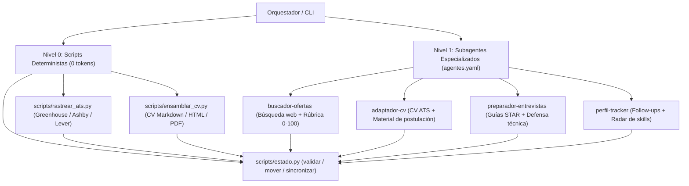

# Career Agent System

Sistema multi-agente de gestión de carrera profesional, búsqueda de vacantes remotas, adaptación de CVs para ATS y seguimiento de postulaciones, diseñado bajo una arquitectura **agnóstica de herramienta** y **cost-aware** (priorizando scripts deterministas a 0 tokens antes de delegar en modelos LLM).

---

## Arquitectura

La lógica de negocio vive en un único lugar ([`.agents/skills/`](.agents/skills/)), mientras que las reglas globales y el contrato multi-agente viven en [`AGENTS.md`](AGENTS.md) (enlazado por `GEMINI.md`, `CLAUDE.md`, `.cursor/rules/` y `.gemini/`).



### Roles y enrutamiento de modelos (`agentes.yaml`)

| Rol | Skill | Responsabilidad | Tier sugerido |
| :--- | :--- | :--- | :--- |
| `perfil-tracker` | [`.agents/skills/perfil-tracker/SKILL.md`](.agents/skills/perfil-tracker/SKILL.md) | Estados, follow-ups, KPIs y radar de brechas | Rápido / económico |
| `buscador-ofertas` | [`.agents/skills/buscador-ofertas/SKILL.md`](.agents/skills/buscador-ofertas/SKILL.md) | Búsqueda web remota y evaluación con rúbrica 0–100 | Medio |
| `adaptador-cv` | [`.agents/skills/adaptador-cv/SKILL.md`](.agents/skills/adaptador-cv/SKILL.md) | Redacción ATS, render HTML/PDF y material de postulación | Medio-alto |
| `preparador-entrevistas` | [`.agents/skills/preparador-entrevistas/SKILL.md`](.agents/skills/preparador-entrevistas/SKILL.md) | Guías de entrevista, historias STAR y negociación | Razonamiento profundo |
| `director` | [`AGENTS.md`](AGENTS.md) | Orquestación, validación de hand-offs y síntesis | Sesión principal |

---

## Estructura del Repositorio

```text
.
├── AGENTS.md                  # Fuente de verdad de reglas globales y protocolo multi-agente
├── GEMINI.md -> AGENTS.md     # Contexto para Google Antigravity
├── CLAUDE.md                  # Contexto para Claude Code
├── agentes.yaml               # Matriz rol → herramienta → modelo
├── .agents/skills/            # Lógica de negocio de cada rol (SKILL.md)
├── .claude/                   # Subagentes y comandos para Claude Code
├── .cursor/                   # Reglas y comandos para Cursor
├── .gemini/                   # Configuración y comandos para Gemini CLI
├── perfil/
│   ├── empresas-target.yaml   # Catálogo de ATS oficiales (Greenhouse, Ashby, Lever)
│   ├── perfil-maestro.example.md
│   └── preferencias.example.md
├── scripts/
│   ├── estado.py              # Motor de estado con locks (validar, sincronizar, listar, mover)
│   ├── rastrear_ats.py        # Rastreador directo de APIs públicas de ATS (0 tokens)
│   ├── ensamblar_cv.py        # Ensamblador determinista de CVs + render HTML/PDF
│   ├── grafo.py               # Grafo de conocimiento del pipeline
│   ├── lanzar.py              # Lanzador headless multi-herramienta
│   ├── pipeline.py            # Orquestador CLI
│   └── drive_sync.py          # Sincronización incremental opcional con rclone
└── requirements.txt
```

---

## Inicio Rápido

1. **Clonar e instalar dependencias:**
   ```bash
   git clone <URL_DEL_REPO>
   cd <REPO>
   python3 -m venv .venv && source .venv/bin/activate
   pip install -r requirements.txt
   ```
   *(Opcional para generar PDFs: tener instalado `google-chrome` o `chromium` en el `PATH`.)*

2. **Configurar tu perfil privado (ignorado por Git):**
   ```bash
   cp perfil/perfil-maestro.example.md perfil/perfil-maestro.md
   cp perfil/preferencias.example.md perfil/preferencias.md
   ```
   Completa ambos archivos con tu experiencia real, filtros y rúbrica de puntaje.

3. **Ejecutar herramientas a 0 tokens:**
   ```bash
   # Validar fichas de ofertas
   python3 scripts/estado.py validar

   # Rastrear vacantes en APIs públicas de ATS (Greenhouse, Ashby, Lever)
   python3 scripts/rastrear_ats.py --buscar --crear-ofertas

   # Sincronizar tablero y reportes
   python3 scripts/estado.py sincronizar
   ```

---

## Privacidad, Seguridad y Veracidad

- **Datos personales fuera de Git:** `.gitignore` excluye `perfil/perfil-maestro.md`, `perfil/preferencias.md`, `ofertas/`, `cvs-generados/`, `entrevistas/`, `postulaciones/`, `logs/`, `.locks/` y cualquier archivo de credenciales (`.env*`, `*.pem`, `*.key`, `credentials*.json`).
- **Veracidad estricta:** Ningún agente puede inventar experiencia, métricas, años, certificaciones ni ejemplos fuera de `perfil/perfil-maestro.md`.
- **Propiedad de archivos y concurrencia:** Cada rol escribe únicamente en sus rutas asignadas y las transiciones de estado pasan por `scripts/estado.py mover` con bloqueo de archivo (`.locks/estado.lock`).

---

## Licencia

Distribuido bajo licencia [MIT](LICENSE).
